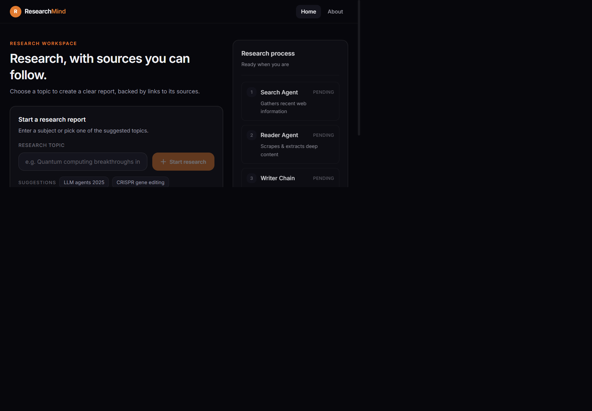
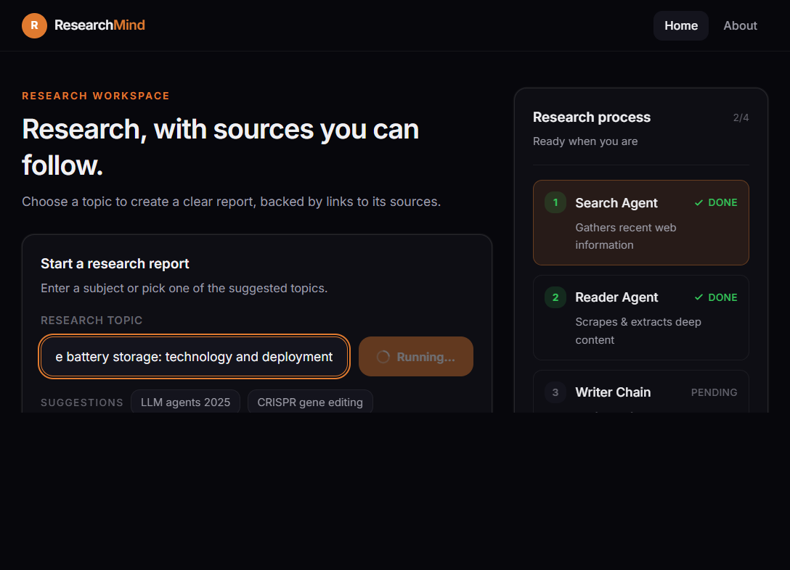
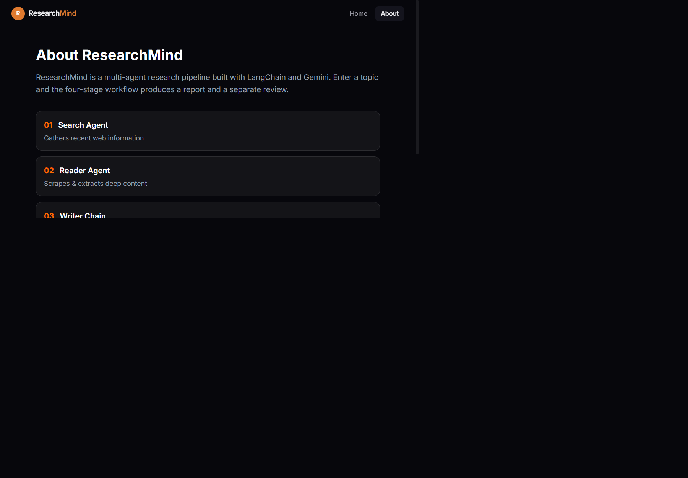
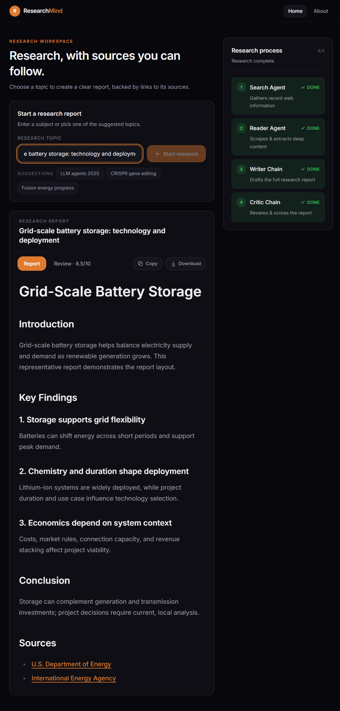
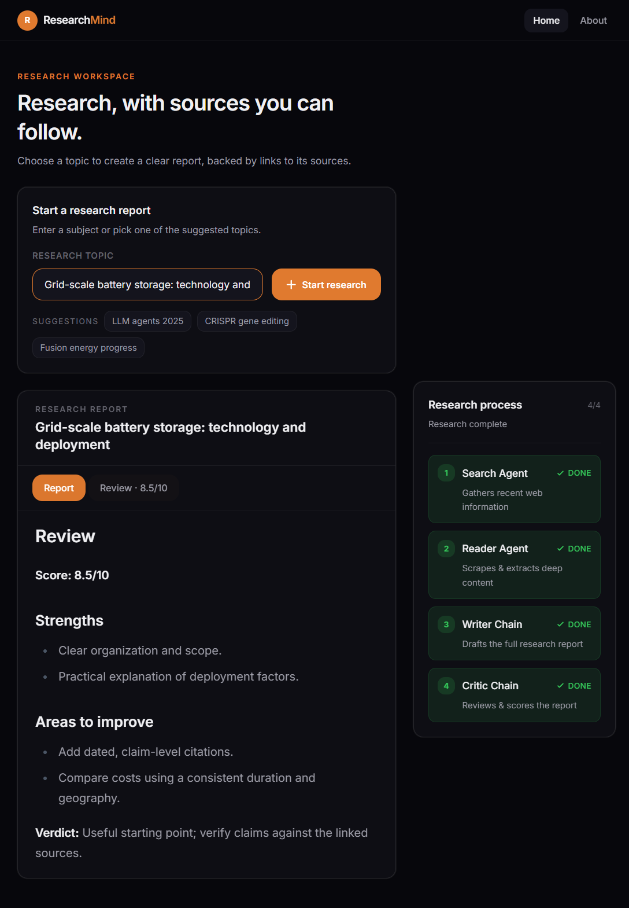
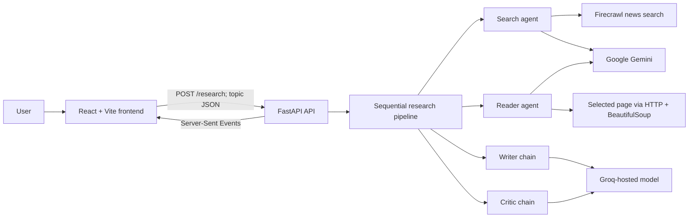
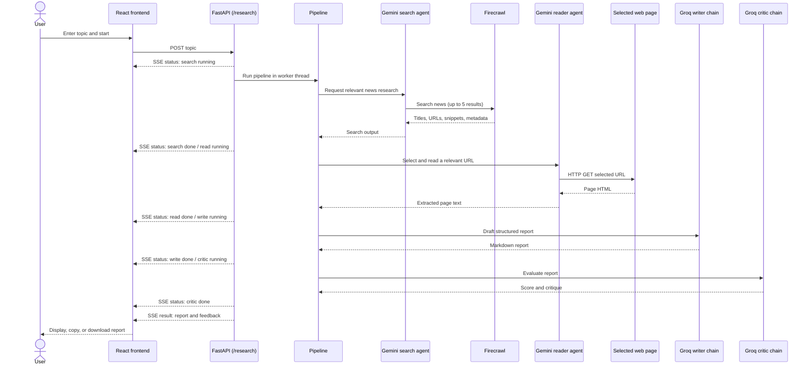

# ResearchMind

> **Project documentation**  
> A multi-agent web research application that turns a topic into a structured,
> AI-drafted report and a separate critique.

**Project status:** Prototype  
**Document scope:** Current implementation, local setup, architecture, and known gaps  
**Last reviewed:** 2026-10-28

## Contents

1. [Executive overview](#1-executive-overview)
2. [Introduction and problem statement](#2-introduction-and-problem-statement)
3. [Real-world use cases](#3-real-world-use-cases)
4. [Users and stakeholders](#4-users-and-stakeholders)
5. [User-facing capabilities](#5-user-facing-capabilities)
6. [Product screenshots](#6-product-screenshots)
7. [Architecture](#7-architecture)
8. [Research pipeline and workflow](#8-research-pipeline-and-workflow)
9. [Technologies and tools](#9-technologies-and-tools)
10. [API reference](#10-api-reference)
11. [Local setup and runbook](#11-local-setup-and-runbook)
12. [Configuration and data handling](#12-configuration-and-data-handling)
13. [Error handling and operational behavior](#13-error-handling-and-operational-behavior)
14. [Security, privacy, and production readiness](#14-security-privacy-and-production-readiness)
15. [Current limitations and known gaps](#15-current-limitations-and-known-gaps)
16. [Suggested production roadmap](#16-suggested-production-roadmap)
17. [Repository map](#17-repository-map)
18. [Glossary](#18-glossary)
19. [Documentation basis](#19-documentation-basis)

## 1. Executive overview

ResearchMind is a web application for researching a user-provided topic. A
React-based interface sends the topic to a Python API. The backend runs a
sequential research workflow: it searches for news, selects and reads a
relevant web page, drafts a report from the gathered material, and asks a
second model call to critique that report. The browser displays progress as
the workflow runs and then presents the report and feedback, with options to
copy or download the report as Markdown.

The project is a useful prototype of an agent-assisted research workflow. It
does not currently provide a persistent research library, user accounts,
formal source verification, or production-grade operational controls.

## 2. Introduction and problem statement

Research often involves several repetitive activities:

1. Finding current information from the web.
2. Opening sources and extracting useful context.
3. Organizing findings into a readable report.
4. Reviewing the report for gaps and clarity.

ResearchMind combines these steps in one interface. Specialized agent/tool
calls handle different parts of the workflow, while the user can see which
stage is active. The result is intended as a research starting point that a
person can review and improve, not as a substitute for professional judgment
or independent verification.

### Project objectives

- Accept a research topic through a simple browser interface.
- Gather recent web-news search results.
- Read a relevant page for additional context.
- Draft an organized report with findings, a conclusion, and source URLs.
- Produce a distinct critique with a score, strengths, and improvement areas.
- Show pipeline progress and surface failures to the user.
- Make the generated report easy to copy or download.

### Current scope

The implemented pipeline is a fixed, sequential flow. Users provide one topic
at a time; there is no visible configuration for the search source, models,
report format, or number of sources.

## 3. Real-world use cases

The following are appropriate **potential uses** of the current workflow,
subject to human review:

| Use case | Example | How the project can help |
|---|---|---|
| News brief preparation | “Recent developments in grid-scale batteries” | Finds news results, reads a selected page, and drafts a concise research report. |
| Early-stage market research | “Current trends in industrial robotics” | Creates an initial overview that an analyst can use to guide further research. |
| Technology landscape review | “Recent progress in CRISPR gene editing” | Collects web context and organizes it into key findings and source links. |
| Student or personal learning | “How are small modular reactors being developed?” | Provides a structured introduction to a topic and a critique to prompt follow-up. |
| Internal knowledge discovery | “Recent changes in browser-based AI tools” | Gives a team a starting brief for discussion or subsequent fact-checking. |

### Human-review guidance

Before relying on a generated report, a user should open the cited sources,
check publication dates and claims, look for missing perspectives, and confirm
that the source is suitable for the intended audience. The critic is another
model-generated output; it is not an independent fact-checker.

## 4. Users and stakeholders

- **Researcher / analyst:** submits a topic, monitors progress, reviews the
  report and feedback, and follows the cited sources.
- **Student / learner:** uses the report to orient themselves before deeper
  study.
- **Product owner:** defines intended audiences, acceptable sources, and
  accuracy and privacy expectations.
- **Developer / operator:** configures API credentials, runs the frontend and
  backend, monitors failures, and maintains provider integrations.

## 5. User-facing capabilities

### Home page

- Text input for a research topic; Enter or the run button starts research.
- Three example topic buttons populate the input.
- Pipeline status cards indicate waiting, running, completed, or failed
  stages.
- A loading message describes the active stage.
- Errors received from the API are shown in the interface.
- The completed report and critic feedback are displayed in separate tabs.
- Report output is rendered as Markdown.
- The report can be copied to the clipboard or downloaded as a `.md` file.

### About page

Explains the four pipeline stages and describes the application as a
LangChain/Gemini-based research workflow.

## 6. Product screenshots

The following captures show the user-facing functionality currently present
in the application. The report and review screenshots use a representative
mock response to demonstrate the interface; live generated content varies
with the topic and external provider responses.

### Research workspace and topic suggestions



### Pipeline progress



### About and workflow stages



### Generated report with copy and download actions



### Critic review and score



## 7. Architecture



### Component responsibilities

| Component | Location | Responsibility |
|---|---|---|
| React application | `frontend/src/` | Topic input, navigation, progress display, report and feedback rendering. |
| Frontend API client | `frontend/src/api.js` | Sends the research request and parses streamed Server-Sent Event data. |
| Streaming API | `backend/main.py` | Starts the pipeline in a background thread and streams status, result, or error events. |
| Pipeline orchestration | `backend/pipelin.py` | Calls search, reader, writer, and critic stages in order. |
| Agent and chain definitions | `backend/agents.py` | Configures Gemini agents and Groq-backed report and critique chains. |
| External research tools | `backend/tools.py` | Performs Firecrawl news search and HTTP-based page text extraction. |
| Alternate step API | `backend/server.py` | Exposes separate `/api/search`, `/api/read`, `/api/write`, and `/api/critic` endpoints. |

`backend/main.py` is the module used by the frontend's `/research` flow. The
same handler remains available at `/api/research` for backwards compatibility.
`backend/server.py` is a separate API implementation exposing individual
stages; it is not called by the current frontend. Both define a FastAPI
application named `app`, so the selected module matters when starting Uvicorn.

## 8. Research pipeline and workflow

### Stage 1 — Search

- The search agent receives an instruction to find recent, reliable, detailed
  information about the submitted topic.
- The agent can call `web_search`.
- `web_search` uses Firecrawl's news source and requests up to five results.
- Each returned item may include a title, URL, snippet/description, source,
  and date.

### Stage 2 — Read

- The reader agent receives the search output, limited to its first 3,000
  characters in the pipeline prompt.
- It is asked to choose a relevant URL and retrieve deeper content.
- The `web_page_scrapping` tool requests the selected URL, removes common
  page chrome (scripts, styles, navigation, footer, and header), extracts
  readable text, and returns at most 3,000 characters.

### Stage 3 — Write

- The pipeline combines the search output and extracted page text.
- The writer chain asks the Groq-hosted model to create a detailed report with
  an introduction, at least three explained key findings, a conclusion, and
  sources/URLs found in the research input.

### Stage 4 — Critique

- A separate prompt asks the Groq-hosted model to assess the drafted report.
- The requested feedback format contains a score out of 10, strengths, areas
  to improve, and a one-line verdict.
- The critique is returned alongside the report; the code does not
  automatically revise the report based on that critique.

### End-to-end sequence



### Stream event shape

The streaming endpoint emits Server-Sent Event records, each with a JSON
object in its `data` field:

```json
{"type":"status","step":"search","status":"running"}
{"type":"status","step":"search","status":"done"}
{"type":"result","report":"...","feedback":"..."}
{"type":"error","step":"read","message":"..."}
```

Statuses are emitted for `search`, `read`, `write`, and `critic`. A successful
run emits a final result containing the report and feedback. An error event
contains the stage active when the exception occurred, if available.

## 9. Technologies and tools

| Area | Technologies observed in the project | Purpose |
|---|---|---|
| Frontend language and UI | JavaScript, React 19 | Interactive single-page interface and component-based rendering. |
| Frontend development/build | Vite 8, `@vitejs/plugin-react` | Local development server and production asset build. |
| Styling | Tailwind CSS 4, `@tailwindcss/vite`, `@tailwindcss/typography` | Utility styling and formatted report typography. |
| Navigation | React Router 7 | Home and About routes. |
| Report rendering | `react-markdown`, `remark-gfm` | Markdown and GitHub-Flavored Markdown display. |
| Backend language/API | Python, FastAPI, Pydantic | HTTP API, request parsing, and response streaming. |
| Agent orchestration | LangChain, LangGraph dependency | Tool-using agents and sequential LLM workflow. |
| Search model | `langchain-google-genai`, Google Gemini | Search and page-reader agents. |
| Report and critique model | `langchain-groq`, Groq | Report drafting and critic feedback. |
| Web search | Firecrawl Python SDK | News-oriented search results. |
| Page extraction | `requests`, BeautifulSoup, `lxml` | Fetching and extracting text from a selected webpage. |
| Configuration | `python-dotenv` | Loading local environment variables from a `.env` file. |
| Backend server | Uvicorn (used to run FastAPI) | ASGI development/runtime server. |

Model identifiers are currently configured in `backend/agents.py`. They are
code-level settings, not user-selectable settings in the interface.

### Technology choices and rationale

| Choice | Rationale in this project | Trade-off / consideration |
|---|---|---|
| React | Component-based UI fits the topic form, status cards, report tabs, and About page. | Adds a client-side build and runtime compared with a server-rendered page. |
| Vite | Provides the current frontend development server and production bundler with a small configuration surface. | Frontend tooling versions should be tested against the supported Node.js versions. |
| FastAPI | Provides a lightweight Python HTTP API and supports streaming progress to the browser. | Production deployments still need authentication, bounded concurrency, and operational hardening. |
| LangChain agents and chains | Reuses tool-calling and prompt/model composition for the search, reading, writing, and review stages. | Prompted agents may produce variable outputs and do not guarantee factual correctness. |
| Google Gemini | Supplies the model integration used by the search and page-reader agents. | Requires an API key, network access, and provider-specific cost and availability controls. |
| Groq-hosted model | Supplies the report-writing and critique calls through the LangChain Groq integration. | Model identifiers and provider behavior are external configuration concerns; generated critique is not independent verification. |
| Firecrawl | Supplies news-oriented web search results through a dedicated search SDK. | Search coverage and result quality depend on the external service and credentials. |
| Server-Sent Events | Delivers incremental pipeline status over the existing HTTP request-response flow. | The client must handle disconnects and partial streams; this implementation has limited cancellation behavior. |
| Markdown | Keeps the generated report portable and supports in-browser rendering plus `.md` download. | There is no PDF export or durable report library in the current implementation. |

These are implementation-fit rationales, not claims that the current
prototype meets production security, reliability, or scale requirements.

## 10. API reference

### `POST /research` — streaming workflow

**Application module:** `backend/main.py`

Request:

```json
{"topic":"Recent advances in fusion energy"}
```

Response: `text/event-stream`, containing status events followed by either a
result event or an error event.

This is the endpoint used by the current frontend. The same handler is
available at `POST /api/research` as a backwards-compatible alias. The
frontend's API base URL is configured with `VITE_BASE_URL`.

### Alternate stage endpoints

**Application module:** `backend/server.py`

These endpoints are implemented separately and are not used by the current
frontend:

| Endpoint | Request fields | Success response |
|---|---|---|
| `POST /api/search` | `topic` | `search_results` |
| `POST /api/read` | `topic`, `search_results` | `scraped_content` |
| `POST /api/write` | `topic`, `search_results`, `scraped_content` | `report` |
| `POST /api/critic` | `report` | `feedback` |

The endpoints return JSON. Errors in these handlers are translated to HTTP
500 responses. When using this alternate API, run Uvicorn against
`server:app`, rather than `main:app`.

## 11. Local setup and runbook

### Prerequisites

- Python 3.10 or later is recommended for the backend environment.
- Node.js and npm compatible with the frontend's Vite 8 toolchain.
- Provider credentials for Firecrawl, Google Gemini, and Groq.
- Internet access for provider calls and webpage retrieval.

### Configure credentials

Create a local `backend/.env` file. Do not commit real credentials:

```dotenv
FIRECRAWL_API_KEY=replace-with-your-firecrawl-key
GOOGLE_API_KEY=replace-with-your-google-ai-key
GROQ_API_KEY=replace-with-your-groq-key
```

The Firecrawl key is read explicitly by `backend/tools.py`; the Google and
Groq integrations use their provider credentials through the corresponding
LangChain integrations. Keep `.env` out of version control.

### Install and start the backend

In a terminal:

```powershell
cd backend
python -m venv .venv
.\.venv\Scripts\Activate.ps1
python -m pip install -r requirements.txt
python -m uvicorn main:app --reload --host 127.0.0.1 --port 8000
```

The API is then available locally at `http://127.0.0.1:8000`; the streaming
route is `POST /research` (also available at `POST /api/research`).

The backend requirements include the direct dependencies used by the API,
agent integrations, and web-research tools. Install them from
`backend/requirements.txt` in a clean virtual environment.

### Install and start the frontend

In a second terminal:

```powershell
cd frontend
npm install
npm run dev
```

Open the local Vite URL printed in the terminal. The API CORS configuration
allows `http://localhost:5173` and the deployed Netlify origin. Set
`VITE_BASE_URL` to the backend base URL, for example
`http://localhost:8000` locally.

### Build and lint the frontend

```powershell
cd frontend
npm run build
npm run lint
```

## 12. Configuration and data handling

### Configuration currently present

- Backend credentials are loaded with `python-dotenv`.
- The streaming frontend API URL is configured with `VITE_BASE_URL`.
- Backend CORS permits the Vite development origin and the deployed Netlify
  frontend origin.
- Additional frontend origins may be configured through `FRONTEND_URL` and
  `FRONTEND_URL_2` in the backend environment; values may include a trailing
  slash.
- Model names and temperatures are configured in `backend/agents.py`.
- The news search result limit and scraped-text limits are fixed in
  `backend/tools.py` and `backend/pipelin.py`.

### Data flow and storage

- The topic is sent from the browser to the backend as JSON.
- Search results, extracted page text, report text, and critique are held in
  process memory for the active request.
- No database, durable report history, or user profile store is implemented.
- The report is only persisted if the user downloads it.
- The project does not define a formal retention policy for provider requests
  or application logs.

## 13. Error handling and operational behavior

- The streaming API sends an `error` event if the worker raises an exception.
- A frontend request or stream failure marks a currently running step as
  failed and displays an error message.
- Firecrawl failures are raised from the search tool with a gateway-style
  error detail.
- The page scraper has a 20-second HTTP timeout and handles several network
  error types with human-readable text.
- The API creates one daemon thread per streaming request; there is no
  explicit worker pool or concurrency limit in the current implementation.
- The application writes pipeline progress and gathered content to backend
  standard output using `print`.

## 14. Security, privacy, and production readiness

The current repository is best treated as a local prototype. Before exposing
it to untrusted users or deploying it for organizational use, address at
least the following:

1. **Restrict page fetching.** The reader agent can choose a URL and the
   scraper makes a server-side HTTP request. Validate schemes and destinations,
   block private, loopback, link-local, and metadata-service addresses, and
   re-check redirects to mitigate server-side request forgery (SSRF).
2. **Validate input.** Add topic length and content constraints, request-size
   limits, and suitable timeouts for all model and provider operations.
3. **Protect the API.** Add authentication/authorization where required,
   rate limiting, concurrency limits, and abuse monitoring.
4. **Configure CORS for deployment.** Keep the allowlist limited to the
   frontend origins actually in use; do not use permissive origins by default.
5. **Avoid leaking exceptions.** Return safe client errors and log detailed
   diagnostics server-side without exposing provider internals or secrets.
6. **Handle cancellation and disconnects.** Ensure provider calls and worker
   threads do not continue indefinitely after the client disconnects.
7. **Establish privacy and retention rules.** Decide whether user topics and
   generated content may be sent to model/search providers, and how long
   application logs may retain them.
8. **Use robust source controls.** Keep provider credentials in a secret
   manager in deployed environments; rotate keys and apply least privilege.
9. **Add observability.** Use structured logs, request/correlation IDs,
   metrics, tracing, and alerts for provider errors, latency, and cost.
10. **Verify generated claims.** Preserve source metadata and dates, require
    citations for factual claims where appropriate, and provide human review
    before consequential use.
11. **Test failure modes.** Add automated coverage for each stage, malformed
    requests, provider failures, scraper timeouts, partial streams, and
    concurrent requests.
12. **Review dependencies.** Pin and regularly audit dependencies, and
    declare every directly imported package in the backend requirements.

These are recommendations for hardening; they are not capabilities claimed
to exist in the current implementation.

## 15. Current limitations and known gaps

- Search is configured for news results; it is not a general-purpose,
  multi-index academic or enterprise search system.
- The workflow asks the reader agent to select a relevant URL, but does not
  guarantee that every search result is read.
- The scraper extracts a short text excerpt and does not preserve structured
  citation metadata or prove that a source supports a generated claim.
- The writer is prompted to list source URLs, but there is no programmatic
  citation validation.
- The critic evaluates the report text; it does not independently retrieve or
  verify evidence.
- There is no user authentication, report history, database, export format
  beyond Markdown, or feedback correction loop.
- The UI does not show the raw source list as a separately structured
  citation panel.
- The API URL is supplied through `VITE_BASE_URL`; update the backend CORS
  allowlist when the deployed frontend origin changes.
- The repository does not currently contain a root-level installation guide,
  automated test suite, container configuration, or deployment manifests.
- Backend dependencies are listed in `backend/requirements.txt`; versions are
  not pinned.

## 16. Suggested production roadmap

### Phase 1 — Reliability

- Declare and pin direct backend dependencies.
- Add automated unit and API tests for the pipeline, stream protocol, and
  failure paths.
- Add typed pipeline state and explicit schemas for search results, report,
  and critique.
- Add request validation, timeouts, cancellation, and bounded concurrency.

### Phase 2 — Trust and safety

- Implement SSRF-safe URL fetching and redirect validation.
- Retain source URLs, titles, publication dates, and excerpts as structured
  provenance.
- Add citation-to-claim review and clear limitations in the UI.
- Define privacy, retention, and provider-data handling policies.

### Phase 3 — Product experience

- Add editable research scope, source type, and report templates.
- Add report history and export options if product requirements call for
  persistence.
- Allow users to request a revision based on critic feedback.
- Improve accessibility, mobile behavior, and source exploration.

### Phase 4 — Deployment and operations

- Externalize API URLs, CORS origins, model settings, and limits.
- Add authentication, quotas, structured observability, and cost tracking.
- Create a deployment architecture, secret-management approach, CI checks,
  and health/readiness probes.
- Run dependency, application-security, and load reviews before launch.

## 17. Repository map

```text
.
├── readme.md
├── PROJECT_DOCUMENTATION.md
├── docs/
│   └── screenshots/
├── backend/
│   ├── agents.py          # Model, agent, writer, and critic setup
│   ├── main.py            # Streaming API used by the frontend
│   ├── pipelin.py         # Sequential pipeline
│   ├── requirements.txt   # Backend Python dependencies
│   ├── server.py          # Alternate per-stage JSON API
│   └── tools.py           # Search and webpage extraction tools
└── frontend/
    ├── package.json       # Frontend scripts and dependencies
    └── src/
        ├── api.js         # Streaming API client
        ├── App.jsx        # Routes and page shell
        ├── steps.js       # Shared pipeline labels
        ├── Components/    # Navigation, status, and report components
        └── Pages/         # Home and About pages
```

## 18. Glossary

- **Agent:** An LLM configured to choose or invoke available tools in response
  to a task.
- **Chain:** A composed sequence of prompt, model, and output parsing steps.
- **Server-Sent Events (SSE):** A streaming HTTP response format used here to
  send progress and completion events from the backend to the browser.
- **Scraping / extraction:** Fetching a webpage and extracting text; this
  implementation does not guarantee access to paywalled or dynamically
  rendered content.
- **Critic:** A model call that provides structured feedback about the
  generated report, not an independent verifier.

## 19. Documentation basis

This document describes the repository's current source and configuration as
inspected at the time it was written. It distinguishes implemented behavior
from recommended future work; provider behavior, model availability, and
external API pricing may change independently of this codebase.
